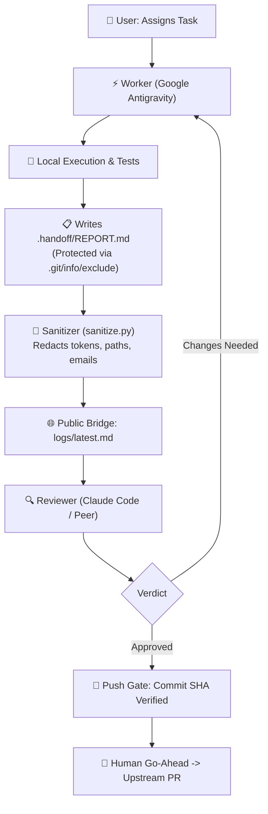

# Agent Bridge 🌉

[](LICENSE)
[](https://github.com/yashpatadiya1724-cmyk/agent-bridge)
[](.agents/skills/agent-bridge/scripts/sanitize.py)

**Agent Bridge** is a lightweight, secure handoff and review protocol connecting **Google Antigravity** (the worker) with **Claude** (the reviewer) and modern coding agents. It enables multi-agent collaboration with automated local secret redaction, isolated branch logs, and a strict human-gated push workflow.

---

## 🎯 Why Agent Bridge?

When coordinating multiple coding agents across different platforms, developers face key challenges:
- ❌ **Accidental Leaks**: Token keys, environment paths, and local usernames getting leaked to public repos.
- ❌ **Messy Handoffs**: Untracked diffs and copy-pasting between chat windows.
- ❌ **Unverified PRs**: Hallucinated code escaping directly to GitHub without independent adversarial review.

**Agent Bridge fixes this:**
- 🛡️ **Zero-Leak Redaction**: Built-in sanitizer scrubs API keys, AWS credentials, Bearer tokens, emails, and filesystem paths before any handoff.
- 🔒 **Git Protection**: Automatically isolates `.handoff/` inside `.git/info/exclude` so work-in-progress notes can never be accidentally committed.
- 👥 **Peer Review Protocol**: Generates structured reports with raw diffs and command outputs for peer review (Claude, Cursor, or human maintainers).
- 🚦 **Human Push Gate**: Outward actions (`git push`, `gh pr create`) require a verified commit SHA approval.

---

## 🔄 Architecture & Workflow



---

## 📦 Installation

### Prerequisites
- Python 3.8+ (for running `sanitize.py`)
- Git 2.30+

### 1. Google Antigravity

#### Workspace-Level (Per-Project)
Copy the skill into your project's agent configuration:
```bash
mkdir -p <your-project>/.agents/skills/
cp -r .agents/skills/agent-bridge <your-project>/.agents/skills/
```

#### Global Installation (Recommended)
Install globally so every Antigravity session has access to the bridge:

* **Windows**:
  ```powershell
  Copy-Item -Recurse -Force .agents\skills\agent-bridge "$env:USERPROFILE\.gemini\config\skills\"
  ```
* **macOS / Linux**:
  ```bash
  cp -r .agents/skills/agent-bridge ~/.gemini/config/skills/
  ```

---

## 🚀 Usage Guide

### Step 1: Assign a Task to the Worker Agent
Prompt Antigravity with your task:
> *"Implement the feature on branch `feature/auth`. Follow agent-bridge skill."*

Antigravity executes the code locally, runs tests, and stores the execution evidence in `.handoff/REPORT.md`.

### Step 2: Publish the Sanitized Report
Say:
> *"publish report"*

The bridge engine:
1. Verifies the target repository is clean.
2. Runs `sanitize.py` on `.handoff/REPORT.md`.
3. Previews the sanitized output and requests your final OK.
4. Commits and pushes `logs/latest.md` to your log repository.
5. Returns the public review link.

### Step 3: Peer Review
Share the `logs/latest.md` link with your reviewer (Claude Code, Cursor, or teammate):
- Reviewer audits the full diff, checks line limits, test results, and regression risks.
- Delivers a verdict:
  ```text
  VERDICT: APPROVE
  APPROVED: <short-sha> | <commit title>
  ```

### Step 4: Verification & Push
Provide the approval line and your confirmation to the worker:
> *"APPROVED: b49aa652 | Fix content-type matching in get_encoding_from_headers"*  
> *"OK push"*

The push gate runs pre-push validations (SHA match, clean status, race checks) and creates the PR.

---

## 🛡️ Built-in Redaction Engine (`sanitize.py`)

The sanitizer automatically scans and redacts sensitive patterns:

| Pattern | Detection | Replacement |
|---|---|---|
| **API Keys** | OpenAI, Anthropic (`sk-...`), Google AI (`AIza...`) | `<api-key>` |
| **Cloud Credentials** | AWS Access Key (`AKIA...`) | `<aws-key>` |
| **Tokens & Secrets** | GitHub PATs (`ghp_...`, `github_pat_...`), Bearer tokens | `<github-token>`, `Bearer <token>` |
| **Personal Identifiers** | Email addresses | `<email>` |
| **System Paths** | Windows (`C:\Users\<user>`), POSIX (`/home/<user>`) | `C:\Users\<user>`, `/home/<user>` |

Run it manually anytime:
```bash
python .agents/skills/agent-bridge/scripts/sanitize.py <input.md> <output.md>
```

---

## 📁 Repository Structure

```text
agent-bridge/
├── .agents/
│   └── skills/
│       └── agent-bridge/
│           ├── SKILL.md             # Core Antigravity skill definition
│           └── scripts/
│               └── sanitize.py      # Secret and path redaction script
├── logs/
│   ├── latest.md                    # Published active handoff report
│   └── README.md                    # Log directory notice
├── LICENSE                          # MIT License
└── README.md                        # Documentation & setup guide
```

---

## 📜 Security & Best Practices

- **Zero Untracked Pushes**: The worker agent never runs `git push` or `gh pr create` without explicit human authorization.
- **Log Hygiene**: Only sanitized markdown is published to `logs/latest.md`. Never place credentials or proprietary customer data in logs.

---

## 📄 License

Distributed under the **MIT License**. See [`LICENSE`](LICENSE) for details.

Developed with ❤️ by [Yash Patadiya](https://github.com/yashpatadiya1724-cmyk).
